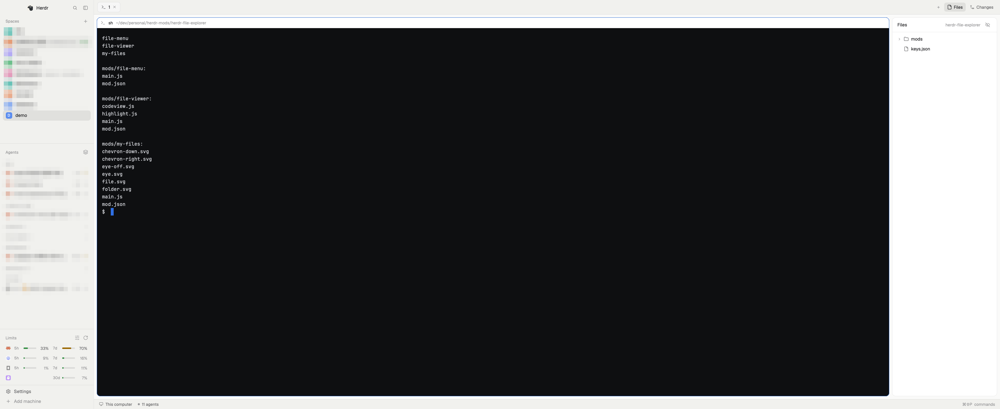

# Paper Dark Terminal

A layout for the [Herdr](https://herdr.dev) desktop app: Herdr's main layout in light paper colors, with every terminal on a near-black card.



## Install

Ask your agent to add this repo as a Herdr layout, or copy the files yourself:

```sh
cp layouts/paper-dark-terminal.json layouts/paper-dark-terminal.svg ~/.config/herdr-app/layouts/
cp themes/paper-dark-terminal.json ~/.config/herdr-app/themes/
herdr-app do layout.switch '{"name":"paper-dark-terminal"}'
```

Use light appearance to see it. In dark appearance it shows Herdr's graphite theme with a near-black terminal area.

## Known limitations

The terminal looks black, but Herdr still treats its background as the white panel color. Two things follow from that.

**Programs that ask for the background color get white.** Codex, for example, then draws its input box in light gray, and the light terminal text on it is hard to read. Have your shell report the real color when this layout is shown. Add this to `~/.zshrc` (or your shell's equivalent):

```zsh
if [[ -n $HC_TERMINAL_ID && -t 1 ]] && grep -q '"layout":"paper-dark-terminal"' ~/.config/herdr-app/shared.json 2>/dev/null; then
  printf '\e]11;#0e0f11\a'
fi
```

Herdr starts agents through an interactive login shell, so this runs before Codex starts. Restart Codex after adding it.

**Reverse-video text is hard to read.** Herdr draws reverse-video text (SGR 7) in the theme background, which this layout keeps white for its panels. Reverse video with default colors, such as `less`'s `(END)`, shows as white on light gray. No setting fixes this today.

See "Watch out" in [RECIPE.md](RECIPE.md) for details.

## License

[MIT](LICENSE)
