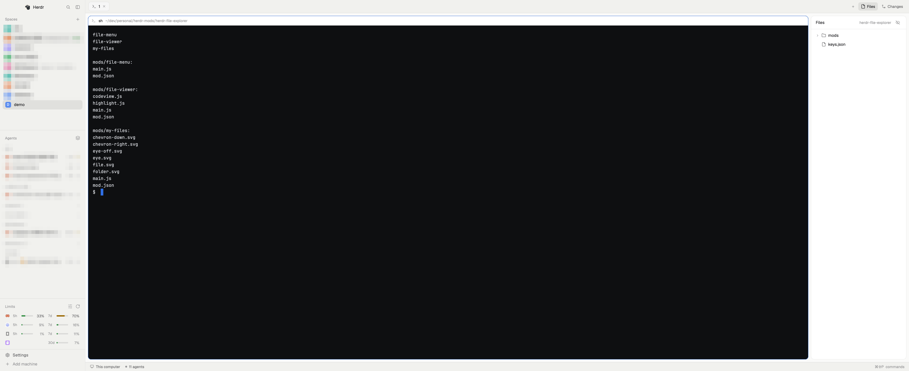

# Paper Dark Terminal

A light, paper-colored Herdr window with dark terminal cards. The sidebar and panels are
off-white and quiet; each terminal pane is a near-black card with a thin border, so the
terminal is the only dark thing on screen. The sidebar adds a Limits block under the Agents
list, and the Files panel on the right is a file explorer that opens files in their own tabs
and has a right-click menu.

## What you see

Left to right:

- **Sidebar**, 268px wide (min 44, max 480, not resizable), background theme `chrome`
  (`#f1f1ee`). Top to bottom:
  - Brand bar, 46px, shipped `workspace-chrome` mod; drags the window. The macOS traffic
    lights sit at x 12, y 16 (`titlebar: "none"`).
  - Spaces list (shipped `spaces`) and Agents list (shipped `agents`), equal weight, min 90px each.
  - Limits, 134px, the `agent-limits` mod: one line per coding agent with its usage windows
    (5h / 7d / 30d bars and percentages).
  - Footer, 69px, `workspace-chrome` with `props: { footer: true }` (Settings, Add machine).
- **Work column**, filling the rest:
  - Tab bar, 42px, shipped `tabs`; drags the window.
  - Body row with 8px padding and 8px gap:
    - The active tab's panes. Each pane is a card: background `#0e0f11`, 1px `border`
      outline, 1px `accent` (`#1f62d0`) outline when focused, radius 10, 8px between panes,
      card shown even for a lone pane. A 30px `pane` header is always shown on top.
    - The right panel, 368px (min 280, max 900), hidden until opened from the tab bar's
      Files / Changes buttons. A stack of `my-files` (active) and shipped `changes`.
  - Status bar, 28px, shipped `workspace-status`.

Window background is `canvas` (`#fafaf9`); dividers are 1px `border`. Terminal padding is
14px horizontal, 12px vertical, and `terminal_opacity` is 0 so the card color shows through.

Theme `paper-dark-terminal` (light): background/surface/popover `#ffffff`, canvas `#fafaf9`,
chrome `#f1f1ee`, raised `#f6f6f6`, foreground `#1b1b1e`, muted `#69696b`, dim `#969698`,
accent `#1f62d0`, border `#00000017`, hover `#0000000c`, selected `#00000012`, working
`#9a6700`, blocked `#c93c2c`, done `#2f6fe4`, idle `#a8a8aa`. Terminal text `#d4d6db`,
selection `#2f4a6e`, cursor `#2f6fe4`, ANSI 0-15 `#45484f #d6525a #368f45 #a3761d #377fdc
#aa5fca #2a8b91 #c8cad0 #838790 #f0a5ad #bad5a2 #ead2a1 #b0cbef #cbb7e6 #a4d5db #f2f2f4`.
In dark appearance the layout uses the shipped `graphite` theme.

## How it behaves

Everything behaves like Herdr's shipped `main` layout (spaces, agents and their statuses,
tabs, panes, the Changes panel), with two replacements:

- The Files panel is `my-files` from the File Explorer mod: click a file to open it in its
  own tab (`file-viewer`), Cmd-click to open it in the default app, right-click for a menu
  (`file-menu`), and the header eye button hides dotfiles. See that mod's RECIPE.
- The Limits block is the Agent Limits mod. See its RECIPE.

## Built from

- `layouts/paper-dark-terminal.json`: a clone of shipped `main` v0.1.11 with the
  `agent-limits` block (id `agent-limits`, `{ px: 134 }`) added as the third child of
  `sidebar-lists`, the files block's mod changed from `files` to `my-files`, the pane
  `background` set to `#0e0f11`, `terminal_opacity: 0`, and
  `theme: { light: "paper-dark-terminal", dark: "graphite" }`.
- `layouts/paper-dark-terminal.svg`: the layout picker's preview.
- `themes/paper-dark-terminal.json`: the colors above.
- Mods in this repo: `my-files`, `file-viewer`, `file-menu` (File Explorer) and
  `agent-limits` (Agent Limits). Shipped mods used: `workspace-chrome`, `spaces`, `agents`,
  `tabs`, `pane`, `changes`, `workspace-status`.
- `keys.json`: the `mod:file-viewer` section (cmd-s save, cmd-shift-v preview, ctrl-w close).
  Merge it into yours.

## Watch out

- `agent-limits` reads coding-agent credentials and calls their usage endpoints; read its
  RECIPE's Watch out before installing. Remove the block from the layout if you don't want it.
- Keep the node ids `sidebar` and `agent-limits`: the Limits mod sizes its own block by id.
- The right panel starts hidden; the tab bar's Files button shows it.
- The terminal's default background is the theme color `background`. Herdr uses the same color for pane headers, the Files and Changes panels and the input fields in the palette, pickers and dialogs. Keep it `#ffffff`. The black comes from the pane frame (`#0e0f11`) showing through a transparent terminal (`terminal_opacity: 0`). Setting `colors.background` dark makes those panels and inputs dark with dark text.
- In the theme file, the top-level `background` decides whether the theme counts as light. It does not change terminal rendering. Keep it `#ffffff`, or the theme moves to the dark list.
- The top-level `foreground` becomes `terminal_foreground` (terminal text). `colors.foreground` is the panel text. They are deliberately different.
- Herdr draws the character under the block cursor, and reverse-video cells (SGR 7), in the theme `background`, which is white here. The cursor is `#2f6fe4` so a white character on it reads (4.65:1). Reverse video with default colors stays white on `#d4d6db` (about 1.5:1) and is hard to read, for example `less`'s `(END)` and search highlights. No setting fixes this today.
- Keep `minimum_contrast` at `1`. It measures against the white `background`, so any higher value that fixes reverse video also turns normal terminal text near-black on the dark card.
- OSC 11 (set default background) sent by a program does not fix reverse video either.
- Herdr answers a background query (`ESC ] 11 ; ? BEL`) with `rgb:ffff/ffff/ffff`, the white theme `background`. Programs that pick colors from it treat the terminal as light. Codex then draws its input box light gray, and the `#d4d6db` text on it is hard to read. After the terminal receives `ESC ] 11 ; #0e0f11 BEL`, Herdr answers `rgb:0e0e/0f0f/1111` and nothing on screen changes. So the shell sends it at startup, only inside Herdr terminals (`HC_TERMINAL_ID` is set) and only while this layout is shown (`"layout":"paper-dark-terminal"` in `~/.config/herdr-app/shared.json`); see the README for the snippet. Herdr starts agents through `zsh -lic`, so it runs before them. A terminal keeps the reported color after a layout switch.
- ANSI 1 to 6 are also panel text colors (Files syntax colors, Changes `+`/`−` counts), so they are mid-brightness: about 4:1 on white and 4.7:1 on `#0e0f11`. ANSI 9 to 14 are graphite's brighter set and used only by terminals.
- A copy of `main` made with `layout.clone` also copies main's theme clicks (`{ "light": "paper", "dark": "graphite" }`), which win over the file. Pick "paper dark terminal" once in Settings → Look on this layout, or run `herdr-app do app.theme '{"name":"paper-dark-terminal"}'`.
- It is a copy of main from app 0.1.11 and does not get main's later changes.

## Done when

- `herdr-app check` passes for each mod and `layout.switch {name: "paper-dark-terminal"}` shows
  the window above: off-white sidebar and panels, near-black terminal cards with a blue
  outline on the focused one.
- The sidebar shows a Limits block under Agents.
- Opening Files shows the folder of the focused pane; clicking a file opens a `file-viewer`
  tab; right-clicking a row opens the file menu.
